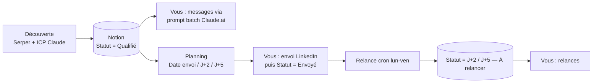

# Pipeline de prospection LinkedIn pour agences SEA (n8n + Notion)

> **EN:** Three n8n workflows that run a LinkedIn outreach pipeline for French SEA/performance agency founders: discovery with Serper + Claude ICP scoring, weekly send-date planning, and automatic follow-up status updates at day 2 and day 5, all tracked in a Notion CRM.
> **EN:** Messages are intentionally written outside n8n (one batched Claude prompt per 10 prospects); sending stays manual.
> **EN:** Built for a freelance targeting agencies; search queries and ICP criteria are editable.

**FR :** Trois workflows n8n qui structurent une prospection LinkedIn : découverte de dirigeants d'agences SEA (Serper + qualification ICP par Claude), planification des dates d'envoi, et mise à jour automatique des statuts de relance à J+2 et J+5 dans un CRM Notion. L'envoi des messages reste manuel.

## Problème → Solution → Pour qui

- **Problème :** la prospection manuelle sur LinkedIn perd du temps en recherche, en suivi des dates et en relances oubliées.
- **Solution :** les workflows trouvent et qualifient les profils, répartissent 10 prospects par jour ouvré avec leurs dates de relance, et mettent à jour les statuts ; vous rédigez (via le prompt batch fourni), envoyez et marquez « Envoyé ».
- **Pour qui :** freelances et prestataires qui prospectent des agences SEA en France. Adaptable à une autre cible en changeant les requêtes Serper et les critères ICP dans le nœud de préparation de la requête Claude.

## Les workflows

| Fichier | Déclenchement | Rôle |
|---|---|---|
| `discovery-agent-v2.json` | manuel | Requêtes Serper → dédoublonnage → qualification ICP Claude → fiche Notion au statut **Qualifié** |
| `planning-semaine.json` | manuel (par ex. le dimanche soir) | Prospects Qualifié / Prêt à envoyer / À relire sans date → `Date envoi` (10 par jour ouvré), `Date J+2`, `Date J+5` |
| `relance-cron.json` | cron `0 6 * * 1-5` | `Envoyé` + date J+2 atteinte → **J+2 — À relancer** ; idem J+5 |
| `discovery-agent-v1.json` | manuel | Version précédente (voir `CHANGELOG.md`), non documentée ici |
| `prompt_messages_batch.md` | à coller dans Claude.ai | Génère les messages de 10 prospects en un appel |

## Résultat

Le dépôt ne contient pas d'exécution réelle. Voici la **structure d'une fiche créée** par la découverte (d'après le nœud de création Notion) — ce n'est pas un enregistrement d'exécution :

| Propriété | Valeur écrite |
|---|---|
| `Agence`, `Rôle`, `LinkedIn` | issus du profil trouvé par Serper |
| `Canal` | `InMail` (valeur fixe) |
| `Douleur` | `Monitoring` ou `Reporting` selon l'évaluation ICP (valeurs de select définies dans le prompt) |
| `Liste` | `A-list` ou `B-list` |
| `Notes` | source et extrait du résultat de recherche |
| `Statut` | `Qualifié` |

<!-- TODO capture: la vue Notion « À rédiger » après une exécution de la découverte (masquer les noms) -->

## Architecture

## Prérequis

- n8n (version minimale non vérifiée) ; fuseau `Europe/Paris` défini dans les paramètres de `planning-semaine.json` et `relance-cron.json`.
- Credentials : Notion API (3 workflows), Serper et Anthropic (découverte v2, deux credentials Header Auth).
- Une base Notion CRM (schéma ci-dessous).
- Coût : non mesuré. Seuls la découverte (Serper + un appel Claude, `claude-sonnet-4-6` dans le code, 30 profils maximum par exécution) et le prompt batch (manuel) consomment des crédits.

## Installation

1. Créer la base Notion (propriétés ci-dessous), la partager avec l'intégration Notion.
2. Importer `discovery-agent-v2.json`, `planning-semaine.json`, `relance-cron.json`.
3. Renseigner `<YOUR_NOTION_DATABASE_ID>` dans le nœud de configuration de chacun (**Config session**, **Config planning**, **Config CRM**).
4. Créer et associer les credentials : Notion, Serper (en-tête `X-API-KEY`), Anthropic (en-tête `x-api-key`). Selon les nœuds de votre version importée, remplacer `<YOUR_NOTION_CREDENTIAL_ID>`, `<YOUR_ANTHROPIC_CREDENTIAL_ID>`, `<YOUR_SERPER_CREDENTIAL_ID>`.
5. Lancer la découverte (**Trigger Manuel**) et vérifier les fiches « Qualifié ».
6. Lancer le planning, puis activer `relance-cron` une fois.
7. Générer les messages avec `prompt_messages_batch.md`, les coller dans la base, envoyer à la main.

## Configuration

| Placeholder / paramètre | Où le trouver | Nœud concerné |
|---|---|---|
| `<YOUR_NOTION_DATABASE_ID>` | URL de la base Notion (32 caractères) | Config session, Config planning, Config CRM ; URL du nœud « Vérifier doublon Notion » dans v1 |
| `<YOUR_NOTION_CREDENTIAL_ID>` | n8n → Credentials (resélectionner) | nœuds Notion / HTTP Notion |
| `<YOUR_ANTHROPIC_CREDENTIAL_ID>` | n8n → Credentials | Évaluer ICP (Claude) |
| `<YOUR_SERPER_CREDENTIAL_ID>`, `<YOUR_SERPER_API_KEY>` | serper.dev | Chercher LinkedIn (Serper) |
| `<YOUR_NOTION_TOKEN>` | Intégration Notion (v1 uniquement : jeton dans un en-tête HTTP) | nœuds HTTP Notion de v1 |
| `max_nouveaux_prospects` (10), `max_profils_icp` (30), `pause_prospect_sec` (1.5) | à ajuster | Config session |
| `prospects_par_jour` (10), `demarrer_aujourdhui_si_semaine` (true) | à ajuster | Config planning |

### Schéma de la base Notion (vérifié dans les JSON)

| Propriété | Type | Écrit / lu par |
|---|---|---|
| `Nom` (ou `Name`) | Title | lu par le planning ; non écrit par la découverte |
| `Agence`, `Rôle`, `Notes` | Texte | écrit par la découverte |
| `LinkedIn` | URL | écrit par la découverte |
| `Canal`, `Douleur`, `Liste` | Select | écrit par la découverte |
| `Statut` | **Select** (pas « Status ») | `Qualifié`, `Prêt à envoyer`, `À relire`, `Envoyé`, `J+2 — À relancer`, `Relance J+2 envoyée`, `J+5 — À relancer`, `Relance J+5 envoyée` |
| `Date envoi`, `Date J+2`, `Date J+5` | Date | écrit par le planning, lu par la relance |
| `Message` | Texte | rempli à la main avec le prompt batch (non utilisé par les workflows) |

Les options de `Douleur` (`Monitoring`, `Reporting`) et de `Statut` doivent exister dans la base : l'API Notion refuse une option inconnue pour un Select.

## Statut et limites

- **Statut : base de départ, utilisée par l'auteur comme CRM de prospection** (pas de preuve d'exécution versionnée dans ce dépôt).
- La découverte n'écrit pas la propriété de titre (`Nom`) ; le planning la lit. À compléter dans le nœud de création si besoin.
- Le cron est `0 6 * * 1-5` avec le fuseau `Europe/Paris` : il s'exécute à 6 h, alors que le nom du nœud indique « 8h Paris ».
- Les messages sont rédigés hors n8n par choix ; le prompt batch est écrit pour l'auteur (nom, positionnement, prix de départ) et doit être adapté.
- LinkedIn : le workflow ne contacte personne ; respectez les conditions d'utilisation de LinkedIn et la réglementation sur la prospection.

## Licence

MIT, voir [LICENSE](LICENSE). Historique des versions : [CHANGELOG.md](CHANGELOG.md).
